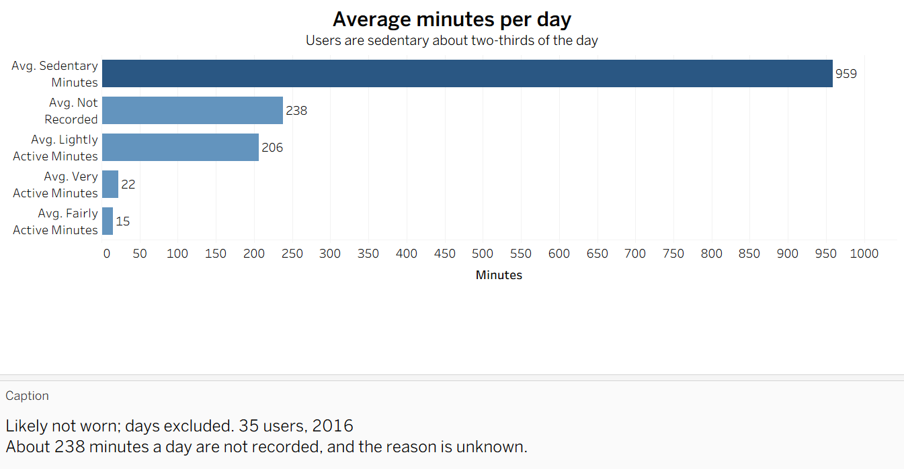
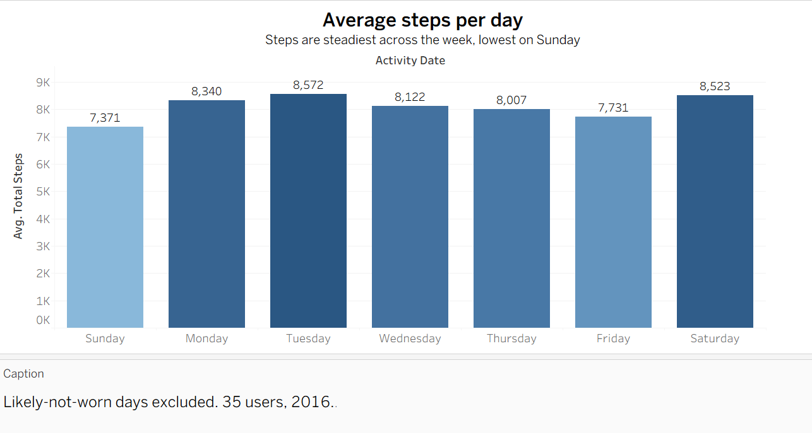
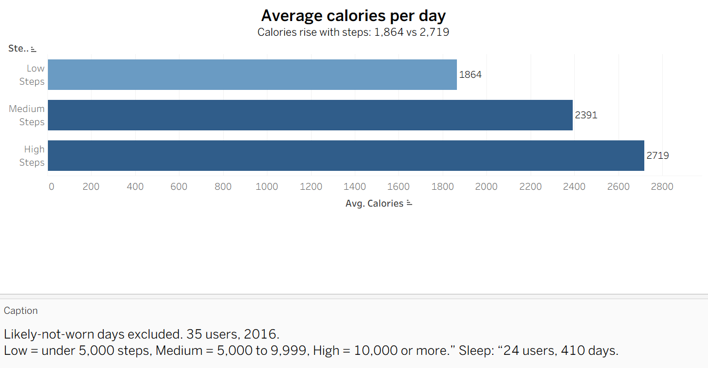
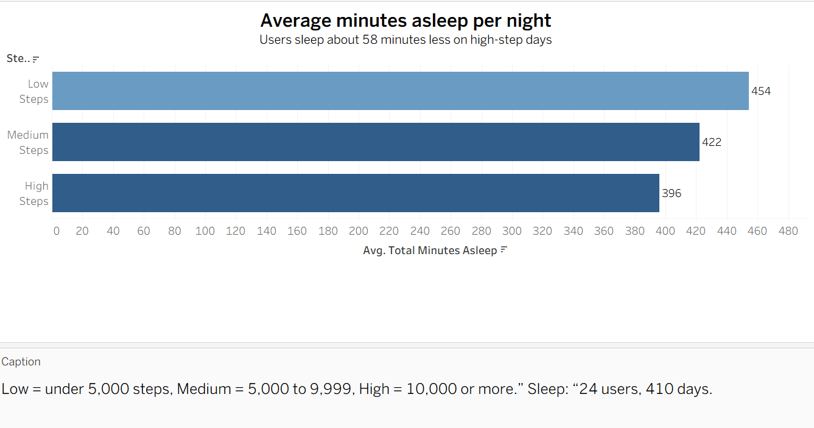

# Bellabeat Case Study: How Can a Wellness Company Play It Smart?

Google Data Analytics Professional Certificate, capstone project (Course 8).

**Author:** Mursal Omar Adan | **Last updated:** 4 November 2026

## Business task

Analyze smart device (Fitbit) usage data to find trends in how people use their devices, and use those insights to guide the marketing strategy of Bellabeat's app.

**Business questions**
1. What are some trends in smart device usage?
2. How could these trends apply to Bellabeat customers?
3. How could these trends help influence Bellabeat's marketing strategy?

## Data

- **Source:** [FitBit Fitness Tracker Data on Kaggle](https://www.kaggle.com/datasets/arashnic/fitbit) (published by Mobius, CC0 public domain)
- **Files used:** `dailyActivity_merged` (two periods: 12 Mar to 12 Apr 2016 and 12 Apr to 12 May 2016) and `sleepDay_merged` (April to May 2016)
- **Credibility (ROCCC):** small sample, 2016 data, and no information about users' motivations (see Limits)

**Process:** Ask, Prepare, Process, Analyze, Share, Act

## Cleaning log

| Date | Cleaning | Description |
|---|---|---|
| 31 Oct 2026 | Loaded the data | Loaded 3 datasets: daily activity (12 Mar to 12 Apr 2016, 457 rows), daily activity (12 Apr to 12 May 2016, 940 rows), and sleep day (413 rows). |
| 31 Oct 2026 | Renamed columns | Made the column names consistent (for example `Activity_Date`, `Total_Steps`, `Sedentary_Minutes`), because the original names were messy. |
| 31 Oct 2026 | Converted dates | Changed `Activity_Date` and `Sleep_Day` from text to datetime, so they can be sorted, compared, and calculated. |
| 31 Oct 2026 | Flagged zero-step and likely-not-worn days | Added `zero_steps_flag` (0 steps) and `likely_not_worn` (0 steps and 1,440 sedentary minutes), because these days could lower the averages. Final counts: 133 zero-step rows and 122 likely-not-worn rows. |
| 31 Oct 2026 | Combined the activity files | Concatenated the two daily activity datasets into one dataset (1,397 rows) to analyze both periods together. |
| 31 Oct 2026 | Removed sleep duplicates | Dropped 3 exact duplicate rows in `sleep_day` (413 to 410 rows), so no day is counted twice. |
| 1 Nov 2026 | Removed the 12 April overlap | Removed 24 rows where the same user and date appeared in both files. Kept the row with more steps (the fuller day), because the March file captured only part of 12 April. The rows were not exact copies, and adding them was rejected because the combined minutes exceeded 1,440 in 14 of 24 pairs. Rows: 1,397 to 1,373. |
| 1 Nov 2026 | Loaded into MySQL | Saved the clean files and loaded them into MySQL (`daily_activity` 1,373 rows, `sleep_day` 410 rows). Reloaded `sleep_day` once after it was loaded twice by mistake (820 rows). |
| 1 Nov 2026 | Recalculated the flags | Recalculated both flag columns in MySQL from `Total_Steps` and `Sedentary_Minutes`, because they were loaded in the wrong order. |

## Cleaning findings and decisions

- No null values, and no duplicates inside the activity files.
- 35 unique IDs in the merged data (the dataset description says 30 users). 2 IDs appear only in the March period.
- 12 users have fewer days than the period (the smallest has 4). Decision: keep them and note the limit.
- Decision: keep zero-step rows in the data, but exclude the 122 likely-not-worn days from averages.
- Limit: some activity in the 24 dropped partial-day rows is not counted.

## Key findings

Method note: averages exclude the 122 likely-not-worn days (0 steps and 1,440 sedentary minutes). The other 11 zero-step days are kept, because they have some recorded activity.

1. **Overall:** 35 users and 1,251 usable days. Average steps are 8,097, and 34.4% of days reach 10,000 steps. Users are sedentary about 959 minutes a day (about 67% of the day), which includes sleep. The data shows moderate movement but cannot show whether it is "enough."
2. **Weekday:** Tuesday has the highest average steps (8,572), and Saturday is close (8,523). Sunday is lowest (7,371), about 1,200 steps below Tuesday. The weekdays are fairly steady, and with 35 users the difference is small. Sunday could be a time to test reminders.
3. **Activity types:** light activity is about 206 minutes a day (14%), and fairly plus very active time is only about 37 minutes (2.5%). Light activity is about 5.6 times larger than fairly and very active time combined. About 238 minutes (4 hours) a day are not recorded in any category, and the reason is unknown.
4. **Calories:** average calories rise with steps: 1,864 (under 5,000 steps), 2,391 (5,000 to 9,999), and 2,719 (10,000 or more). Steps and calories go together, but this does not prove cause. Body size and other factors matter, and the device only estimates calories.
5. **Sleep:** on days with sleep data (410 days, 24 users), average sleep falls as steps rise: 454 minutes on low-step days, 422 on medium-step days, and 396 on high-step days, about 58 minutes less. This does not prove that steps reduce sleep. Schedule and stress may matter, and the same users appear in several groups.

## Top three recommendations (Bellabeat app)

I chose the Bellabeat app because it connects to all Bellabeat products. These are ideas to test, not proven results.

1. **Send movement reminders**
   - Users are sedentary about 959 minutes a day, with only about 37 minutes fairly or very active.
   - Send short, friendly reminders to move after long periods of inactivity.
2. **Show activity, calories, and sleep together**
   - Calories rise with steps (1,864 to 2,719), and users sleep about 58 minutes less on high-step days.
   - Show all three on one screen, so users see how their habits connect.
3. **Find out why the device is not worn**
   - About 9% of days (122 of 1,373) show the device was likely not worn.
   - Ask a small group of users why, and send gentle wear reminders.

## Visualization

[View the interactive dashboard on Tableau Public](https://public.tableau.com/views/Dash_17938057104800/Dashboard1)

## Limits and next steps

**Limits of the data**
- Only 35 Fitbit users (not Bellabeat customers), from 2016, over about two months
- Sleep data for one month and 24 users
- 122 of 1,373 days (about 9%) likely not worn, so they were excluded from averages
- 24 partial-day rows removed, so some activity is not counted

**Not used**
- Hourly, minute-level, heart rate, and weight files. They take much more work, and the daily data answers the business task.

**Next steps**
- Add the hourly data to see when in the day users are active
- Test the reminders with real Bellabeat users

## Tools used

| Tool | What it was used for |
|---|---|
| Python (pandas, NumPy) | Investigation, cleaning, and merging the datasets |
| MySQL | Analyzing the data |
| Tableau | Visualizing the data |
| Microsoft PowerPoint | Presenting the findings |

## Files in this repository

- `daily_activity.csv` (cleaned daily activity data, 1,373 rows)
- `sleep_day.csv` (cleaned sleep data, 410 rows)
- `Bellabeat_case_study.ipynb` (Python investigation and cleaning)
- `Bellabeat_case_study.sql` (MySQL analysis queries)
- `Bellabeat_presentation.pptx` (presentation)
- `Case Study 2 How can a wellness company play it smart.pdf` (case study brief)
- `Visuals` (Four visual screenshots)
